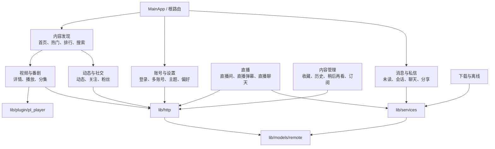

# 功能领域地图

从页面目录进入对应领域，再沿 API、服务和模型追踪调用。

模块边界见[架构概览](architecture.md)；启动、播放、下载和消息的时序见[运行流程图](runtime-flows.md)。

## 领域关系图

箭头表示功能间常见入口和关联。

## 首页与内容发现

- 页面：`lib/pages/main/`、`home/`、`rcmd/`、`hot/`、`rank/`、`popular_*`、`search*`。
- API/模型：`lib/http/api.dart`、`search.dart`、`lib/models/remote/` 下的 `popular/`、`search/` 等。
- 入口：根路由 `/` → `MainApp`；具体子页见 `lib/router/app_pages.dart`。
- 推荐和热门功能受响应结构、分页及登录状态影响；改动后先检查对应领域的测试。
- 推荐与热门列表通过 `lib/common/widgets/feed_pagination.dart` 按实际滚动范围分页：首屏补足可视区，滚动后按页面指定的预取距离加载，避免预加载区构建末项时连续请求。对应测试为 `test/common/widgets/feed_pagination_test.dart`。

## 视频、文章、番剧与音频

- 页面：`lib/pages/video/`、`article/`、`article_list/`、`pgc/`、`audio/`、`music/`。
- API：`lib/http/video.dart`、`pgc.dart`、`music.dart`、`reply.dart`。
- 播放：`lib/plugin/pl_player/`；播放诊断见 `lib/services/diagnostics/player_diagnostics.dart`。
- 模型：`lib/models/remote/video/`、`pgc/` 及顶层视频模型。
- 修改前确认详情、播放地址和弹幕使用的资源标识（aid、bvid、cid），再调整页面。

### 播放性能与资源控制

- Windows 弹幕使用预处理渲染器，复用文字布局和栅格图片，并对缓存和活动工作集设定条目数与字节预算，减少逐帧重复布局和图片栅格化的工作量。实现见 `lib/pages/danmaku/windows_renderer.dart`、`raster_cache.dart` 和 `trajectory.dart`。
- Windows 视频输出尺寸按启动时所在显示器限制；Android 可选实验性地按设备物理分辨率缩小输出 Surface，默认关闭。尺寸变化会合并并串行提交，Android 还等待纹理帧交接，避免快速旋转或切换时重复调整旧 Surface。输出限幅减少渲染表面和纹理开销；源视频仍按其原始分辨率解码。
- 点播与直播共享播放器时，播放会话按页面归属和请求代次管理；快速切源复用原生播放器、控制器和纹理资源。Android 对 MediaCodec、Surface 和图像输出错误采用有界恢复与回退；网络读取中断可按当前媒体和缓冲状态尝试恢复。
- Windows 独立播放窗口由 `lib/services/desktop_playback_windows.dart` 管理，每个子进程使用自己的播放器。渲染资源生命周期与超分切换见[Windows 视频输出](windows-video-output.md)。
- 直播消息连接复用有序解析 worker；弹幕数据按分段与条目数限界缓存，降低长时间播放时的对象和任务堆积。
- 实际帧率和内存占用取决于设备、编码与弹幕密度，测量口径见[维护与排障](maintenance.md#复现和测量)。

## 弹幕与评论

- 使用说明见[评论与表情包](comments-and-emotes.md)。评论长按菜单由 `lib/pages/video/reply/widgets/reply_item_grpc.dart` 的 `morePanel` 共用，覆盖主评论和楼中楼；拉黑调用 `VideoHttp.relationMod`，绑定确认前的账号。
- 表情包入口为输入面板的设置按钮。管理与预览位于 `lib/pages/emote/manage.dart`、`preview.dart`；请求集中在 `ReplyHttp`。详情接口返回 `emotes`，模型同时兼容列表接口的 `emote` 字段。分类筛选位于未添加页签，预览页面通过 Navigator 压入页面栈。
- 页面：`lib/pages/danmaku/`、`danmaku_block/`、`main_reply/`、`my_reply/`。
- API/模型：`lib/http/danmaku.dart`、`reply.dart`，`lib/models/remote/danmaku/`、`reply/`。
- 渲染：通用组件和播放器插件；直播弹幕另走直播间链路。
- 视频弹幕和直播消息的生命周期不同。修改渲染或消息队列时分别检查两条链路和对应测试。
- 视频弹幕支持相似内容合并、重复字号放大与帧率档位；设置入口和规则见[弹幕合并与帧率设置](danmaku-merge.md)。合并实现位于 `lib/pages/danmaku/merge.dart`，过滤与后台结果接入位于 `controller.dart`；相关测试见 `test/pages/danmaku/`。

## 直播

- 页面：`lib/pages/live/`、`live_room/`、`live_search/`、`live_follow/`、`live_dm_block/`。
- API：`lib/http/live.dart`。
- 服务：`lib/services/live_stream/live.dart`、`live_packet.dart`、`live_packet_decoder.dart`。
- 排查直播问题时，分别检查连接、包解码、历史与未读消息、渲染和退出清理。

## 账号、登录与会员

- 页面：`login/`、`login_devices/`、`login_log/`、`member/`、`member_profile/` 等。
- API：`lib/http/login.dart`、`member.dart`、`user.dart`、`fan.dart`、`follow.dart`。
- 服务/本地状态：`lib/services/account_service.dart`、`lib/utils/accounts/`、`lib/utils/storage*`。
- 安全：严禁把 Cookie、Token、二维码登录信息或完整账号数据写入文档、日志和 issue。

## 动态、关注与粉丝

- 页面：`dynamics*`、`follow*`、`fan/`。
- API：`lib/http/dynamics.dart`、`follow.dart`、`fan.dart`。
- 模型：`lib/models/remote/dynamic/`、`follow/`。
- 互动操作通常依赖登录状态及 CSRF/请求上下文。排查失败时核对实际请求与响应。

## 消息、私信与分享

| 功能 | 页面或入口 | 业务实现 |
| --- | --- | --- |
| 未读角标 | `home/`、`main/`、`whisper/` | `overview.dart` |
| 回复、@、点赞和系统通知 | `msg_feed_top/` | `feed.dart`、`feed_notifier.dart`、`feed_adapters.dart` |
| 私信会话及二级列表 | `whisper/`、`whisper_secondary/` | `sessions.dart`、`session_models.dart`、`session_providers.dart` |
| 聊天、历史、发送和撤回 | `whisper_detail/` | `conversation.dart`、`conversation_providers.dart`、`message_models.dart` |
| 接收设置、关键词屏蔽、联系设置 | `whisper_settings/`、`whisper_block/`、`whisper_link_setting/` | `settings.dart` |
| 私信分享及附言 | `share/`；调用入口见 `lib/utils/page_utils.dart` | `sharing.dart`、`sharing_adapter.dart` |

页面路径相对于 `lib/pages/`，业务文件位于 `lib/services/messaging/`。HTTP 和 gRPC 协议入口分别为 `lib/http/msg.dart`、`lib/grpc/im.dart`；适配器把响应转换成业务模型，页面订阅 Riverpod 状态。

修改时先核对主账号 Session 和资源所有者，再检查分页、写入结果及已读同步。发送结果待确认时应核对聊天记录，重复发送可能产生重复消息。详细约定见[消息模块](../lib/services/messaging/README.md)，回归测试位于 `test/services/messaging/`。

## 收藏、历史、稍后再看与订阅

- 页面：`fav*`、`history*`、`later*`、`subscription*`。
- API：`lib/http/fav.dart`、`lib/http/pgc.dart` 以及 `lib/models/remote/history/`、`later/` 等响应模型。
- 模型：`lib/models/remote/fav/`、`history/`、`later/`。
- 检查分页、排序、文件夹类型和 PGC/UGC 分支，确认使用了对应的响应模型。

## 下载与离线文件

- 页面：`lib/pages/download/`。
- 服务：`lib/services/download/download_manager.dart`、`download_service.dart`、`download_repository.dart`、`response_adapter.dart`、`stream_writer.dart`。
- API/配置：`lib/http/download.dart`，下载路径初始化在 `lib/app/app_paths.dart`，设置键在 `lib/utils/storage_key.dart`。
- 下载异常通常与目录权限、磁盘空间、网络重试、流式写入回压或任务退出顺序有关。

## 设置、主题与本地能力

- 页面：`lib/pages/setting/`、`settings_search/`、`space_setting/`。
- 基础设施：`lib/common/style.dart`、`lib/utils/theme_utils.dart`、`storage_pref.dart`、`platform_utils.dart`。
- Windows 还涉及窗口管理、WebView、托盘和路径；Android 还涉及权限、屏幕方向、JNI。

## WebView、分享、DLNA 与第三方能力

- 页面：`webview/`、`share/`、`dlna/`、`sponsor_block/`、`bubble/`。
- 相关依赖和代码：`flutter_inappwebview`、`dlna_dart`、`share_plus` 等，具体调用从页面 import 反查。
- 这些功能存在平台差异，新增逻辑时检查 Android 和 Windows 的编译路径。

## 修改一个功能时

1. 在 `lib/router/app_pages.dart` 找到页面路由。
2. 检查 `view.dart` 中的状态持有者和事件处理。
3. 沿 import 追踪到 `lib/http` 或 `lib/services`。
4. 核对响应模型及空值、分页和错误处理。
5. 查找对应的 `test/<domain>/` 测试，按需补充回归覆盖。
6. 运行 `fvm flutter analyze` 和相关测试；涉及平台行为时，再执行对应构建或设备验证。
