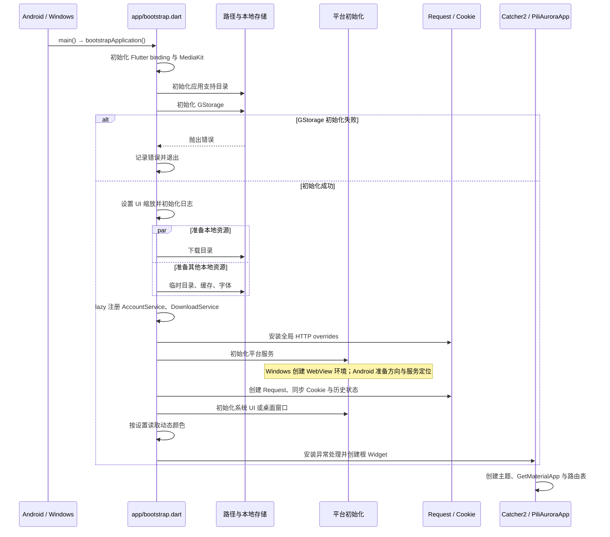
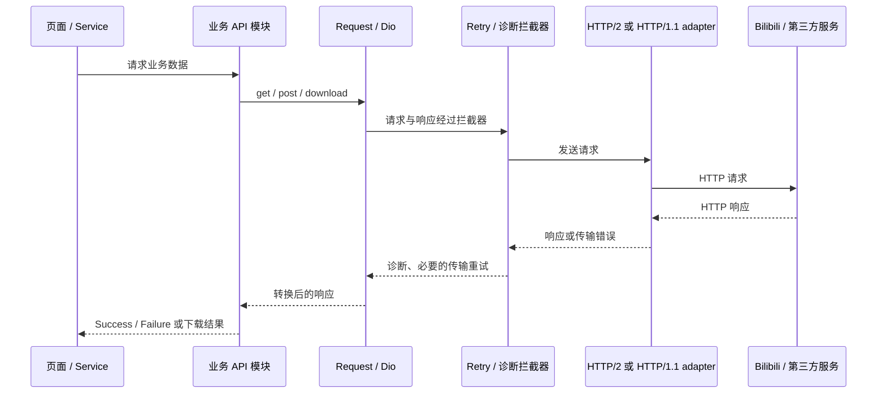
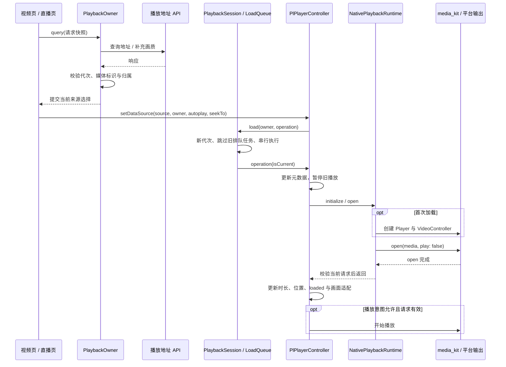
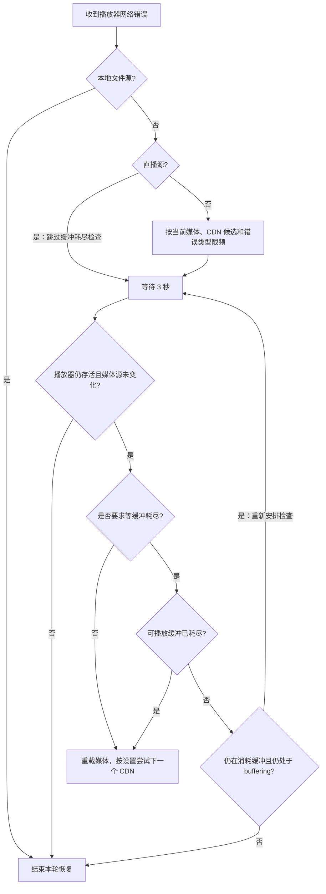
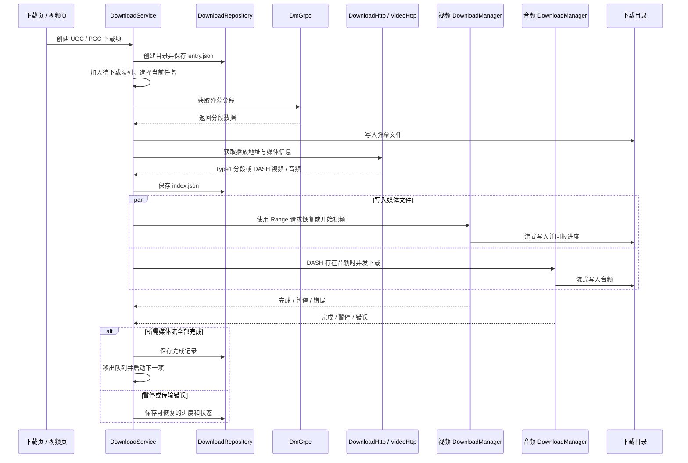
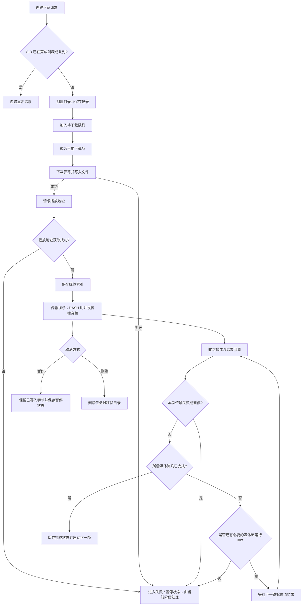
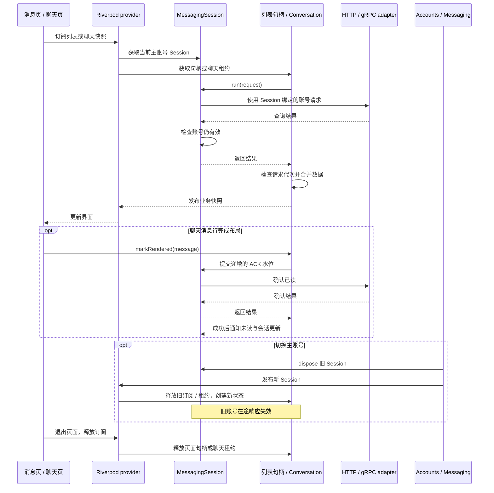
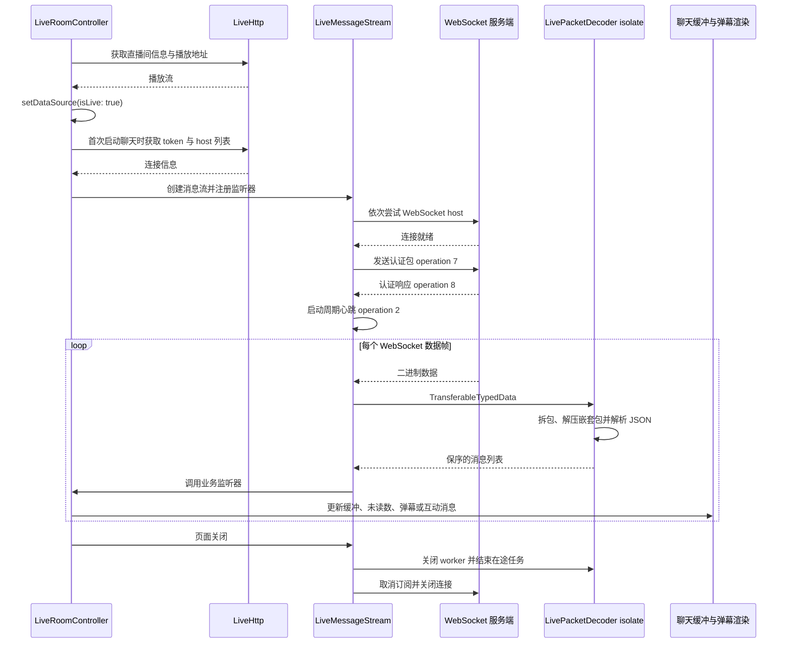

# 运行流程图

## 应用启动

`main.dart` 调用 `bootstrapApplication()`。Windows 的 Cookie 同步会读取 WebView 环境，因此该环境要先于 `Request.setCookie()` 初始化。

`GStorage` 初始化失败时，应用记录错误后退出。下载路径、临时目录、缓存和字体并行准备，`AccountService` 与 `DownloadService` 通过 `lazyPut` 延迟创建。实现见 [`bootstrap.dart`](../lib/app/bootstrap.dart)、[`platform_setup.dart`](../lib/app/platform_setup.dart) 和 [`app.dart`](../lib/app/app.dart)。

## HTTP 请求

业务 API 使用 `Request` 创建的 Dio 客户端。HTTP/2 开启时配置 HTTP/1.1 fallback；重试、诊断和压缩响应转换由请求层处理。

`Request.get()` 和 `Request.post()` 会把 `DioException` 转成含错误消息的 `Response`，调用层仍需检查业务响应。重试条件见 [`retry_interceptor.dart`](../lib/http/retry_interceptor.dart)。

`_CustomHttpOverrides` 在调试模式或 `Pref.badCertificateCallback` 开启时接受无效证书，此时 TLS 证书校验会降低。

## 播放器切源与网络恢复

### 请求、切源与页面归属

视频页与直播页通过 `PlaybackSession.attach()` 借用共享播放器。最近进入的页面拥有加载权；返回上一页面时显式激活其 `PlaybackOwner`，关闭页面时释放借用。页面被替换时，其在途查询同步失效，返回该页面后也不会重新接受这些旧结果。

地址查询绑定请求开始时的媒体标识。新查询立即执行，并取消上一轮在途 HTTP 请求；响应与补充画质结果提交前检查请求代次及页面归属。`VideoPlaybackSource` 将画质、编码、独立音轨与 CDN 地址解析成一次选择；页面用这份选择提交加载，字幕和播放信息沿用该媒体的有效性检查。

已发出的原生操作保留在串行链中，返回后再检查代次。快速切源复用原生资源；释放最后一份借用后，先使会话与资源不可见，再等待在途加载结束并销毁播放器，避免 `open` 与 `dispose` 并发。

实现见 [`playback_session.dart`](../lib/plugin/pl_player/playback/playback_session.dart)、[`native_playback_runtime.dart`](../lib/plugin/pl_player/playback/native_playback_runtime.dart) 和 [`playback_source.dart`](../lib/pages/video/playback_source.dart)。

### 网络错误恢复

连接中断和媒体读取截断进入该链；HTTP 403 不按 CDN 故障重试。`utils/playback_network_recovery.dart` 识别网络读取错误，[`playback/network_recovery.dart`](../lib/plugin/pl_player/playback/network_recovery.dart) 管理当前媒体的计时器、限频与缓冲等待。切源会释放恢复状态，当前媒体的错误风暴合并为一个计时器，终止读取可升级已有的缓冲等待。分离音视频的读取错误先保留主视频剩余缓存，耗尽后再重载；主媒体的播放与缓存同时恢复推进时，可以取消本轮网络重载。加载队列繁忙时继续等待，保留本轮恢复机会。

网络源的音频读取或解码错误同时交给 [`playback/audio_recovery.dart`](../lib/plugin/pl_player/playback/audio_recovery.dart)。它先观察 2 秒，音频时间戳继续推进且与播放位置同步时保持播放；缓存中的音频仍有效时也不提前重载。确认音频停滞后，先异步重载当前外部音轨，mpv 将其同步到视频位置；确认仍未恢复时，再通过加载队列执行一次保留位置与播放意图的整段重载，按多 CDN 设置选择后备地址。听视频或没有外部音轨的来源直接使用整段重载兜底。

每轮最多尝试一次音轨重连和一次整段重载；失败后降低观察频率并仅提示一次。音频连续健康 30 秒后重新开放预算。暂停、缓冲、静音、拖动或接近片尾时让出恢复，恢复播放后继续检查遗留故障。切源和关闭使旧观察失效；mpv 的外部音轨异步命令绑定原生播放生命周期，不占用页面加载队列。观察依据音频时间戳而非音量，内容本身的无声片段不会触发恢复。

点播重载保留位置，直播重载不设置起始位置。切换画质、音质或重新解析已加载媒体时保留位置与播放意图。两者先暂停加载，完成后检查媒体有效性与最新播放意图；加载期间用户主动暂停时不会被恢复操作覆盖。开启多 CDN 时，直播仅使用当前协议、格式和编码提供的候选地址。

Windows 在确定硬件或软件后端后注册纹理，硬件初始化失败时先释放 GL 资源再进入软件路径。Android 保留既有 MediaCodec、Surface 与解码恢复实现。GPU、MediaCodec、Surface 行为和帧率仍需在目标设备验证。

## 下载

### 任务时序

下载记录由 `DownloadRepository` 持久化，`DownloadService` 维护待下载队列和当前任务，`DownloadManager` 负责单路媒体流。DASH 视频与音频可并发传输；任务只有在所需媒体流都完成后才标记完成。恢复时根据已有文件长度发送 Range 请求；暂停会保留已写入字节，删除则由服务移除对应目录。

### 任务状态

实现与测试：[`download_service.dart`](../lib/services/download/download_service.dart)、[`download_repository.dart`](../lib/services/download/download_repository.dart)、[`download_manager.dart`](../lib/services/download/download_manager.dart)；`test/services/download/`。

## 账号消息与私信

消息页面沿用 GetX 路由，通过 Riverpod 获取当前主账号的 `MessagingSession` 和业务快照。未读概览、会话列表及聊天缓存由 Session 共享；分类消息句柄随页面订阅释放。状态所有权与协议入口见[消息模块](../lib/services/messaging/README.md)。

私信分享由 `PageUtils.pmShare` 获取当前 Session 的 `MessageSharing`，将它传入分享页；发送时从同一聊天缓存获取租约。发送文本、图片和分享共用该聊天的发送锁。分享卡片确认成功后才发送附言；消息发送请求成功或结果待确认时，重新查询时间线并废弃发送前的读取。网络层关闭消息写请求的自动重试，结果待确认时页面提示核对聊天记录。卡片与附言分别请求，部分成功的结果保留已发送信息。

聊天读取历史时保留表情映射，刷新使旧历史页失效；消息按稳定标识合并。ACK 失败后等待更高渲染水位或手动刷新重试。系统通知先展示查询结果，再异步确认已读，失败时保留数据和未读数。

## 直播消息与弹幕

视频播放和聊天使用独立连接。页面从 `LiveHttp` 获取播放地址；聊天另取连接信息，再由 WebSocket 接收弹幕和互动消息。

每条连接复用一个解析 worker。关闭或 worker 异常会结束在途任务；损坏的数据包会被跳过。实现见 [`live.dart`](../lib/services/live_stream/live.dart)、[`live_packet_decoder.dart`](../lib/services/live_stream/live_packet_decoder.dart) 和 [`live_packet.dart`](../lib/services/live_stream/live_packet.dart)，测试位于 `test/services/live_stream/`。
